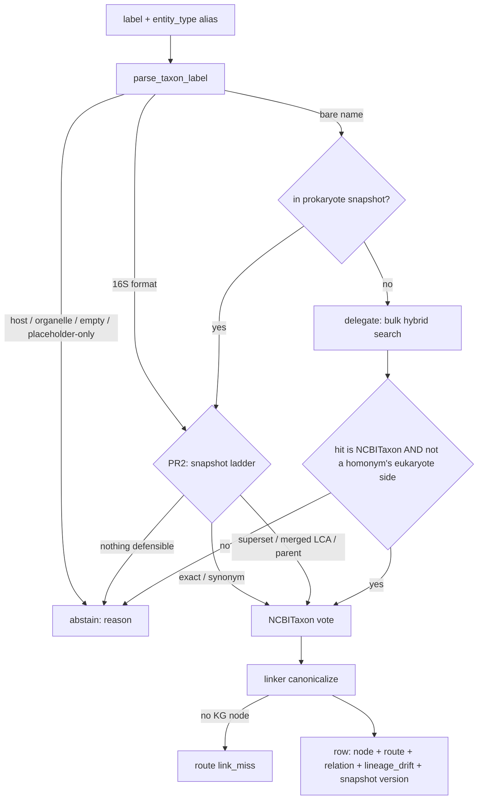
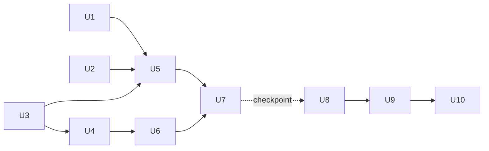

# feat: 16S taxon label resolution

**Target repo:** biomapper2 (branch `feat/16s-taxon-labels`, rebased on `dev` bd251c9). PRs go to the fork `trentleslie/biomapper2`, base `dev`.

> **Dispatch scope (approved 2026-11-19): PR1 only.**
> - Implement U1, U2, U3, U4, U5, and U7's benchmark run and checkpoint report.
> - U6 (stratum freeze, blocked on naming the blind adjudicator) and U8, U9, U10 (PR2, after the checkpoint) are **out of scope** for this dispatch. A reviewer must not report them as unaddressed.
> - Use branch `feat/16s-taxon-labels-pr1`, created from `origin/dev`.
> - Copy this plan and its requirements doc from `~/projects/biomapper2-wt-16s/docs/` into the branch in its first commit.
> - U7's "open PR1" and greptile-loop steps are done by the pipeline's own PR and Greptile stages.

The first commit on this branch adds this plan and its origin requirements doc (`docs/brainstorms/2026-11-18-16s-taxon-label-resolution-requirements.md`). Neither exists on `dev` before that.

## Overview

Public BioMapper users send 16S classifier labels (Greengenes 13_8, SILVA, RDP, MGnify, Greengenes2, bare names) with `entity_type="microbiome"`. Each row should come back as one of these:
- the right NCBITaxon KG node
- a declared broad parent
- an explicit abstention with a reason
- `link_miss`: the chosen taxid has no KRAKEN node
- a `delegated` bare-name result

A row whose caller passed an explicit `annotators` list carries a null route, which signals the 16S guarantees didn't apply.

It should never come back as a wrong-kingdom or duplicate-namespace node. Delivery is two PRs with a checkpoint between them.

- **PR1** is search-based and cheap. It adds the parser, the aliases, the NCBITaxon-only selection, a prokaryote guard backed by a pinned NCBI snapshot, and placeholder/host abstention. It also lands the benchmark harness, re-adjudicates the truth set, and freezes the gate stratum.
- **Checkpoint.** Benchmark PR1, then reconfirm PR2's scope with Trent.
- **PR2** adds the deterministic snapshot ladder, the typed per-row route and relation fields, and the CI-lower-bound merge gate.

## Problem Frame

See origin. Baseline: vault `.../16s_probe/datasets/run_20261118T182527Z`, 1,721 labels from 7 public sources, KRAKEN 2.3.0.
- Raw labels: 4% acceptable. After a throwaway cleaner: 85% (unit-weighted 81%).
- 87 commits to UMLS/EFO/NCIT duplicate nodes.
- 68 eukaryote commits. Only 17 are prokaryote homonyms; the rest are clone codes and organelles (counted against the defective truth set).
- The abstention baseline (1 of 108) rests on a truth set with known defects, which R19 fixes.

## Requirements Trace

| ID | Summary | Slice | Unit |
|---|---|---|---|
| R1 | Taxon aliases map to `biolink:OrganismTaxon` | PR1 | U2 |
| R2 | Parse every baseline format, truncate at genus, SILVA depth as a hint, drop padded repeats | PR1 | U1 |
| R3 | `sk__` is domain; `k__` is domain without `sk__`, kingdom with it | PR1 (parser) | U1 |
| R4 | NCBITaxon only; no duplicate-node commits | PR1 | U2, U5 |
| R5 | Unique same-rank match is exact plus `lineage_drift`; phylum/class conflict vetoes | PR2 | U8 |
| R6 | Legacy phylum names map to the renamed phylum, never the kingdom | PR1 (snapshot) + PR2 | U3, U8 |
| R7 | Superset, merged-LCA and parent-walk give broad matches | PR2 | U8 |
| R8 | A broad parent must not contradict NCBI | PR2 | U8 |
| R9 | No eukaryote or homonym commits | PR1 | U3, U5 |
| R10 | Abstain with reason; no generic search on 16S labels by default; explicit `annotators` honored | PR1 (abstain) + PR2 (reason fields) | U5, U9 |
| R11 | Host/organelle labels abstain | PR1 | U5 |
| R12 | Bare names: snapshot first, then delegate with the homonym guard | PR1 (guard) + PR2 (ladder) | U5, U8 |
| R13 | Row fields: route, relation, `lineage_drift`, snapshot version; null on non-taxon rows (justification dropped, c5) | PR2 | U9 |
| R14 | Selection is deterministic and offline; `link_miss` route; linkage rate reported; fail loud; kill switch scope | PR1: kill switch and fail-loud snapshot only (PR1 selection is deliberately search-based). PR2: offline deterministic selection and `link_miss` | U3, U5, U8, U9 |
| R16 | Public pinned benchmark, saved by default | PR1 | U4 |
| R17 | Merge gate: safety zeros, abstention ≥ 90%, stratum CI lower bound ≥ 90%, no regression below PR1 | PR1 (freeze) + PR2 (gate) | U6, U10 |
| R18 | Blind audit covers abstentions and `lineage_drift` rows | PR2 | U10 |
| R19 | Re-adjudicate no-node truth rows before quoting any number | PR1 | U4 |

R15 (`concept_drift`) moved to follow-up (see origin).

## Scope Boundaries

- Prokaryote 16S labels only. ITS and 18S labels are out of scope.
- No GTDB or SILVA identifiers emitted.
- No species-level resolution.
- No measurement provenance.
- No KRAKEN changes.
- The engine-level `status` field stays absent. The abstain reason travels in the route field and the certificate's reserved `refusal_reason`.

### Deferred to Separate Tasks
- **Client `biomapper` repo:** surface the new fields, add `microbiome` to `list_entity_types`, and document the 16S input contract and the `annotators` override caveat. Separate PR after PR2.
- **`concept_drift`** for split genera (former R15), using a curated split-genus list.
- **Merged/stale taxid retry on `link_miss`**, only if PR2's `link_miss` rate warrants it.
- **SILVA 138.x/144 and GG2 real-dataset rows**, once MGnify's v2 API filters work.

## Context & Research

### Relevant Code and Patterns
- **Annotators and engine.** `core/annotation_engine.py`: registry in `AnnotationEngine.__init__`, `_select_annotators`, the `prefer_human`/`preferred_prefixes` gate in `annotate`, and the four output columns `assigned_ids`, `annotator_availability`, `annotator_source`, `kestrel_endpoints_used`. Hooks in `core/annotators/base.py`: `build_availability_cache`, `get_availability`, `get_source`.
  - OrganismTaxon is not a Gene/Protein category, so it receives `preferred_prefixes` once configured.
  - An explicit `annotators` list bypasses `_select_annotators`, which matches R10's override.
- **Hybrid search.** `core/annotators/kestrel_hybrid.py`: `_kestrel_hybrid_search` (bulk), `_select_canonical`.
  - **`_select_canonical` falls back to the non-canonical top-1 when no preferred-prefix row exists.** The taxon annotator must not inherit that fallback, or R4 breaks.
  - Rows carry `id`, `name`, `score`, `synonyms`, `prefixes` and `categories`, with no lineage, which is why the guard needs the snapshot.
- **Lipid annotator (anti-pattern for us).** `core/annotators/goslin_lipid.py` calls its private Kestrel instance per row through `get_annotations`, which returns only the chosen node. The taxon annotator must use one bulk `_kestrel_hybrid_search` and filter rows itself.
- **Entity-type standardization.** `biolink_client.py:standardize_entity_type` applies `singularize` before the alias lookup. Live behavior today:
  - `16s` becomes `"16"`
  - `taxa` is left unchanged
  - `bacteria`/`bacterium` resolve to `biolink:Bacterium`
  - `organism` resolves to `biolink:IndividualOrganism`

  R1 must match the raw, normalized string before `singularize`, deliberately overriding those two Biolink matches.
- **Snapshot precedent.** `core/icd10cm_hierarchy.py`: `PACKAGED_SNAPSHOT` via `importlib.resources`, `.version` sidecar, `load_or_raise`, `is_present`, `version`, `reset`. The fixture lives in `tests/fixtures/icd10cm_hierarchy/`. Config overrides the path via `monkeypatch.setattr(config, ...)`.
- **Row fields.** `core/resolver.py`: `MAPPING_FIELDS`, `mapping_fields` (precedence ICD > lipid), `mapping_predicate_for`. A new field must also be added to:
  - the `mapper.py` entity and dataset paths, plus the helper-column drop list
  - the certificate `mapping_provenance` mirror
  - `api/models/responses.py` `EntityMappingResult`
  - `api/routes/mapping.py` explicit kwargs
  - `tests/test_mapping_relation_field.py` (asserts the exact tuple), `tests/test_response_schemas.py`, `README.md`

  The ICD fields (`icd10cm_route`, `icd10cm_snapshot_version`) are the precedent.
- **Certificate.** `core/certificate.py` reserves `refusal_reason` (flat column `certificate_refusal_reason`). Non-SmallMolecule rows get state `NOT_APPLICABLE`.
- **Fault isolation (new on dev bd251c9).** `core/fault_tracking.py`: `record_kestrel_fault` and row/dataset recording via contextvars. A Kestrel failure inside the taxon annotator must be recorded as a fault, never reported as an abstention.
- **Tests.**
  - Mock Kestrel with `monkeypatch.setattr(module, "kestrel_request", fake)` or `patch.object(ann, "_kestrel_hybrid_search", ...)`.
  - Live tests are marked `[integration, requires_api]`.
  - `scripts/check.sh` runs ruff, black, pyright, then pytest, including requires_api tests.
  - `.gitignore` already re-includes `src/biomapper2/data/**/*.tsv` and `*.json`.
- **Studies.** `studies/analysis/icd10cm_twin_control.py` always writes `results/<name>_<UTC>.json` with input sha256s and the KG build. The git SHA plus dirty-flag precedent is `studies/kestrel_fault_benchmark/runner.py`.

### Institutional Learnings
- **Kestrel can't distinguish species or kingdoms.** Gene-ortholog doc (`docs/solutions/integration-issues/human-gene-symbols-resolve-to-wrong-species-orthologs-2026-06-15.md`): Kestrel filters can't separate species. The prokaryote guard must use the pinned snapshot.
- **Prefix spelling.** Read the live prefix string (`docs/solutions/build-errors/equivalent-ids-prefix-mismatch-...`). Is it `NCBITaxon`?
- **Fixtures.** Build them from recorded responses (vault `hand-built-fixture-hid-a-live-production-bug`, `trustworthy-gates-invoke-test-real-shape-faithful-fallbacks`). No OrganismTaxon hybrid fixture exists today.
- **Fail closed.**
  - A missing snapshot raises (vault `fail-closed-guards-must-not-no-op-on-absent-input`).
  - Missing evidence is `unknown`, not a contradiction (vault `absent-evidence-is-unverifiable-not-wrong`).
  - The gate fails closed on an empty or shrunk population (vault `hardening-a-benchmark-gate-against-false-clean-holes`).
- **Gold defects.** Gold sets carry defects. Adjudicate through an independent path (vault `adjudicate-benchmark-gold-with-independent-third-path`), and score with equivalence sets that include merged taxids (vault `benchmark-scorer-defects-under-credited-resolver`).
- **Run pinning.** Pin the engine SHA, KG build and snapshot version at the start and end of each run. Never quote rows with errors. Re-derive headline numbers independently (vault `attribute-benchmark-rerun-deltas...`, `reproduce-benchmark-numbers-with-independent-rederivation`).
- **Tracking data files.** Pinned data must be added with an explicit `git add` and confirmed with `git ls-files` (`docs/solutions/runtime-errors/gitignore-globs-exclude-pinned-benchmark-data-...`).

### External References (validated 2026-11-18, live NCBI)
- Balvočiūtė & Huson 2017, doi:10.1186/s12864-017-3501-4: name, rank and synonym mapping with nearest-ancestor fallback.
- NCBI rank change, March 2025 (domain, kingdom, cellular root): ncbiinsights.ncbi.nlm.nih.gov/2025/02/27/new-ranks-ncbi-taxonomy/
- Oren & Garrity 2021, doi:10.1099/ijsem.0.005056: the 42 phylum names. "Firmicutes" is now a Synonym of kingdom Bacillati (1783272). On Bacillota (1239) it appears only as GenbankCommonName/BlastName.
- TaxonKit (MIT) is used as a build-time oracle. ete is GPL-3 and is not used.
- Homonyms: Bacillus 1386/55087, Proteus 583/210425.
- SSSOM, doi:10.1093/database/baac035.

## Key Technical Decisions

- **The snapshot moves into PR1.** PR1's prokaryote filter (R9) needs lineage data that Kestrel rows don't carry. PR1 uses the snapshot only to decide whether a hit taxid is a prokaryote and whether a name is a homonym. The ladder (PR2) reuses it. The origin's slicing listed the snapshot under PR2; this follows the "prokaryote filter in PR1" decision.
- **Snapshot contents.** Prokaryote nodes from domain to genus, with names in these classes: scientific name, synonym, equivalent name, includes, and genbank common name **restricted to phylum rank** (for R6). The snapshot also records merged ids, plus a derived **homonym list**: prokaryote names at genus level and above that also name a non-prokaryote node. Both are built from one taxdump by a script and cross-checked against TaxonKit `name2taxid`/`lineage` at build time. Over 5 MB packaged: stop and ask.
- **R6 mechanism.** Phylum-restricted genbank common names in the snapshot pick up "firmicutes" on Bacillota. There is no runtime rename table. The 42 Oren & Garrity legacy names exist only as **test data**: a test asserts each resolves at phylum rank through the snapshot's name classes. Route `synonym` covers every non-scientific name class used (synonym, equivalent name, includes, phylum-rank genbank common name).
- **Snapshot keeps every node on the path.** For each prokaryote node from domain to genus, every ancestor is kept whatever its rank, including clade and no-rank nodes such as FCB group, ANME-2 cluster and other cluster/group nodes. Parent pointers therefore always resolve inside the snapshot, and `is_prokaryote` is true for clade nodes too.
- **Homonym list stores taxids, not just names.** Each entry records the prokaryote name and the **non-prokaryote taxids** that share it (e.g. Bacillus → 55087, Proteus → 210425). Guards check the **hit's taxid** against those ids.
- **One alias source of truth.** `api/kestrel_discovery.py` already has an `ALIASES` map (microbiome/taxonomy → OrganismTaxon) that `/entity-types` serves, but `standardize_entity_type` ignores it. U2 makes both read one shared taxon-alias constant, so the advertised and accepted aliases can't drift.
- **Side channel: reuse `annotator_source`** (challenge c1).
  - `TaxonLabelAnnotator.get_source` returns its route or abstain reason (e.g. `exact`, `parent:family`, `abstain:host_or_organelle`) from its `build_availability_cache` cache.
  - The existing per-row, per-slug source map already covers every annotated row on the bulk, single and skip paths, and the mapper already reads it on both paths.
  - `lineage_drift` rides on the vote metadata, following the Goslin `matched_level` precedent in `core/resolver.py`.
  - The snapshot version comes from the loader's global `version()`, as with ICD.
  - Route and reason strings come from a module-level constant set, so a typo fails a test.
  - Per-row state stays off annotator instances (one `Mapper` serves concurrent API requests).
  - The `get_source` docstring is updated to say the channel can carry a route.
- **Bulk path.** The taxon annotator parses every term, runs a single bulk hybrid search on the unique cleaned names inside `build_availability_cache`, and derives votes, availability and side records from that cache.
- **Selection is the annotator's own.** It keeps only rows with an NCBITaxon `id` whose taxid is a prokaryote in the snapshot and isn't a homonym's non-prokaryote side. It never falls back to a UMLS/EFO top-1.
- **Explicit `annotators` lists are honored unchanged (R10).** The taxon annotator doesn't run, so the route is **null**. A null route on an OrganismTaxon row is the documented signal that the guarantees didn't apply. `delegated` is reserved for bare names the taxon annotator itself sent to search.
- **Kill switch.** `TAXON_LABEL_ANNOTATOR_ENABLED` (env `BIOMAPPER_TAXON_LABEL_ANNOTATOR`, default on) restores the generic hybrid annotator for OrganismTaxon. The aliases and the NCBITaxon preference stay.
- **Faults are not abstentions.** A Kestrel fault during the taxon annotator's search is recorded through `record_kestrel_fault`. The row's route stays null, never `abstain:*`.

## Open Questions

### Resolved During Planning
- **Which channel carries route and reason?** The existing `annotator_source` map, via `get_source` (see Key Technical Decisions). No new engine column.
- **Can the PR1 prokaryote filter run without the snapshot?** No. The snapshot moves into PR1.
- **Does OrganismTaxon receive `preferred_prefixes` with `prefer_human=True`?** Yes, once configured; it isn't a human-applicable category.
- **Does an explicit `annotators` list bypass selection?** Yes. It's honored per R10.

### Deferred to Implementation
- **Exact NCBITaxon prefix spelling in KRAKEN, and the OrganismTaxon hybrid row shape.** U2 records one live call as a fixture.
- **Packaged snapshot size.** Measured in U3, with the 5 MB stop line.
- **Precise "parent contradicts NCBI" test (R8).** Directional rule, which U8 pins with scenarios:
  - The parent must be a named ancestor in the label that resolves in the snapshot.
  - The genus-token cross-check (the candidate parent must also be an ancestor of the NCBI genus that the label's genus token names) applies **only to `latin` and `superset` classes**, where the label claims that genus.
  - `informal`, `bracketed` and `incertae_sedis` classes (`Ruminococcus2`, `[Ruminococcus]`) explicitly mean "not that genus". The label's own parent stands there, so `Ruminococcus2` under `f__Lachnospiraceae` gives broad Lachnospiraceae.
- **SILVA padded-repeat detection details.** U1.

### Needed before U6 (stratum freeze)
- **[User decision] The blind adjudicator.** A colleague, Trent working from a sheet with no rule tags or answers, or an isolated agent with LPSN/NCBI access that Trent spot-checks.

## High-Level Technical Design

> *This illustrates the intended approach and is directional guidance for review, not implementation specification. The implementing agent should treat it as context, not code to reproduce.*

In PR1, the "16S format" branch runs cleaned-name bulk hybrid search through the guard G instead of the ladder S.

## Implementation Units

### PR1

- [x] **U1: 16S label parser**

**Goal:** Turn a label string into a deterministic parse: levels, query name and rank, label class, and whether it is in 16S format.
**Requirements:** R2, R3
**Dependencies:** none
**Files:** create `src/biomapper2/core/taxon_label.py`; test `tests/test_taxon_label.py`
**Approach:**
- Prefix grammar:
  - `Root;` is optional.
  - `sk__` is domain. `k__` is domain without `sk__`, kingdom with it.
  - `p c o f g` keep their usual ranks. `d__` is domain unless its value is `denovo…`.
  - SILVA `D_n__` is depth, used as a rank hint only.
  - Parsing stops at `s__`, `t__`, `D_6__` and `d__denovo…`.
- Padded repeats (a level repeating its parent's name) are dropped.
- Placeholders (uncultured, unidentified, unclassified, unknown, metagenome, ambiguous_taxa, incertae sedis, empty) are never the query name.
- Class precedence:
  1. eukaryote
  2. organelle
  3. bracketed
  4. incertae_sedis
  5. merged (`-` or `/`)
  6. superset (`_N`, `_A(_N)`, sensu stricto, GG2 suffix)
  7. latin, including `Candidatus` with `_` normalized
  8. informal (clone codes)
- Pure function, no I/O.

**Patterns to follow:** `core/annotators/goslin_grammar.py` (a pure, deterministic grammar wrapper).
**Test scenarios:**
- Happy path, one row per baseline format, each giving the expected query name and rank:
  - GG `...;g__Dorea` → Dorea, genus
  - SILVA `D_5__Bifidobacterium`
  - MGnify `sk__Bacteria;k__;...;g__Alistipes`
  - HMP `Root;p__...;g__Alistipes`
- Edge cases:
  - Empty trailing `g__` gives the family query.
  - `D_1__Firmicutes;D_5__uncultured` gives phylum Firmicutes.
  - A SILVA padded repeat (`D_4__X;D_5__X`) is dropped, so the query rank is family.
  - MGnify `sk__Bacteria;k__Bacillati;...` gives kingdom for `k__`.
  - Species-like levels (`s__[Ruminococcus]_gnavus`, `D_6__...`, `d__denovo15445`) are truncated.
  - `Candidatus_Saccharibacteria` normalizes to `Candidatus Saccharibacteria`.
- Classes:
  - `Ruminococcus2` → informal
  - `Lachnospiracea_incertae_sedis` → incertae_sedis
  - `Escherichia/Shigella` and `Escherichia-Shigella` → merged
  - `Prevotella_9` and `Faecalibacterium_A_123` → superset
  - `[Ruminococcus]` and `[Eubacterium] coprostanoligenes group` → bracketed
  - `AKIW659` → informal
  - `sk__Eukaryota;k__Metazoa;p__Chordata` → eukaryote
  - `c__Chloroplast` → organelle
  - `Unclassified` → empty
- Bare names: `Bacteroides` and `Homo sapiens` give `is_16s_format=False` and rank None.

**Verification:** every format row in the baseline `labels.tsv` parses without error. The parse class distribution is recorded in the PR body.

- [x] **U2: Aliases and NCBITaxon preference**

**Goal:** Route taxon entity types to OrganismTaxon and make NCBITaxon the canonical namespace.
**Requirements:** R1, R4
**Dependencies:** none
**Files:** modify `src/biomapper2/biolink_client.py`, `src/biomapper2/config.py`; test `tests/test_biolink_client.py`, `tests/test_annotation_engine_canonical.py`; create fixture `tests/fixtures/kestrel_hybrid_search_organism_taxon.json`, recorded live
**Approach:**
- Match the normalized raw string against the taxon aliases **before** `singularize`. Aliases: microbiome, microbe, microbes, taxon, taxa, taxonomy, organism, bacteria, bacterium, 16s.
- Add `CATEGORY_PREFERRED_NAMESPACES["biolink:OrganismTaxon"]` with the prefix spelling verified live, and record the date in the comment.
- Record one live OrganismTaxon hybrid-search response (e.g. "Prevotellaceae", "Bacillus") as the fixture.
- Put the ten aliases in one shared constant, read by both `standardize_entity_type` and `api/kestrel_discovery.ALIASES`.
- `tests/test_annotation_engine_canonical.py::test_unconfigured_category_yields_none` currently uses OrganismTaxon. Switch it to a still-unconfigured category (e.g. `biolink:Pathway`).

**Test scenarios:**
- Happy path: each of the ten aliases → `biolink:OrganismTaxon`.
- Edge cases:
  - `Bacteria` and `ORGANISM` (case) → OrganismTaxon.
  - `metabolite`, `lipid` and `protein` are unchanged.
- Consistency: the taxon aliases served by `/entity-types` equal those accepted by `standardize_entity_type`.
- Integration: with the kill switch off (generic hybrid selected), an OrganismTaxon engine call passes `preferred_prefixes == {NCBITaxon}` to hybrid search. With it on, the same kwargs reach the taxon annotator.
- Regression: `_select_canonical` on the recorded fixture prefers `NCBITaxon:171552` over `UMLS:C1080666`.

**Verification:** the alias tests pass. The SmallMolecule/Disease canonical tests pass with only the unconfigured-category test retargeted.

- [x] **U3: NCBI prokaryote taxonomy snapshot and homonym list**

**Goal:** A pinned, packaged, versioned snapshot plus a loader exposing only what PR1 uses, offline: prokaryote membership, homonymy, rank-scoped name lookup and merged ids. The data file keeps parent pointers, so U8 adds the lineage and LCA helpers without a rebuild (challenge c3). If the U4 truth fix turns out to need lineage, add the lineage helper here and defer only LCA.
**Requirements:** R6, R9, R14 (fail loud)
**Dependencies:** none
**Files:**
- create `scripts/build_ncbi_taxon_snapshot.py`, `src/biomapper2/core/ncbi_taxonomy.py`
- create `src/biomapper2/data/ncbi_taxonomy/prokaryote_taxa_<date>.tsv`, `homonyms_<date>.tsv` and `.version`
- create `tests/fixtures/ncbi_taxonomy/` (a small subset produced by the build script from the real taxdump)
- test `tests/test_ncbi_taxonomy.py`

**Approach:**
- The build script downloads or reads `taxdump.tar.gz` (about 80 MB). It keeps Bacteria (2) and Archaea (2157) nodes from domain to genus, **plus every ancestor on each path whatever its rank** (clade, no rank). It handles both `superkingdom` and `domain` rank spellings.
- Name classes kept:
  - scientific name
  - synonym
  - equivalent name
  - includes
  - genbank common name, at phylum rank only
- It writes merged ids and the homonym list. The sidecar records the taxdump date and sha256.
- Optional `--verify-with-taxonkit` cross-checks a sample of names and lineages and fails on disagreement. TaxonKit isn't installed locally. The build step downloads the pinned MIT release binary (a single static Go binary from its GitHub releases) into a temp dir, and records its version in the sidecar. TaxonKit is never a package dependency.
- The loader mirrors `icd10cm_hierarchy`: `load_or_raise`, `is_present`, `version`, `reset`, and a config path override.

**Patterns to follow:** `core/icd10cm_hierarchy.py`, `config.derive_refmet_snapshot_version`.
**Test scenarios:**
- Happy path:
  - Ruminococcus genus → 1263.
  - Blautia genus → 572511.
  - A merged old taxid maps to its current id.
- Edge cases:
  - "Firmicutes" at phylum rank → 1239, never 1783272.
  - All 42 Oren & Garrity legacy phylum names resolve at phylum rank.
  - "Actinobacteria" at class rank → 1760; at phylum rank → 201174.
  - `is_prokaryote(210425)` (salamander Proteus) is False.
  - `is_prokaryote` of a clade node (FCB group) is True.
  - Every parent pointer resolves inside the snapshot.
  - The homonym list maps Bacillus → 55087 and Proteus → 210425.
- Error paths:
  - A malformed row raises.
  - A configured but missing file raises from `load_or_raise`.
  - An absent sidecar gives version None and a loud warning, per the ICD precedent.

**Verification:**
- The packaged size is recorded and under 5 MB.
- `git ls-files` shows the data files.
- The TaxonKit cross-check report is attached to the PR.

- [x] **U4: Truth re-adjudication and benchmark harness**

**Goal:** Fix the no-node truth rows (R19), pin the panel in the repo, and run it through `Mapper`, saving results by default.
**Requirements:** R16, R19
**Dependencies:** U3, so the truth fix can use snapshot name resolution as one input
**Files:**
- create `studies/analysis/taxon_16s_benchmark.py` and `studies/analysis/taxon_16s_truth_fix.py`
- create `studies/analysis/data/taxon_16s/`: `labels.tsv`, `truth.json`, `truth_fix_log.tsv`, `sources.json`, `SHA256SUMS`
- test `tests/test_taxon_16s_benchmark_scoring.py`

**Approach:**
- **Truth fix.** For every no-node (cat c) row, normalize `Candidatus_` and look up the deepest named rank through an **independent path**: live NCBI E-utilities with all name classes, not the snapshot alone. Move resolvable rows to cat a or b, and log every move with its evidence. Rows where the two paths disagree go to a human list.
- **Harness.**
  - Runs `Mapper.map_dataset_to_kg(entity_type="microbiome")` against the configured Kestrel.
  - Scores with the vault scorer categories, ported, using **equivalence sets**: merged taxids count as the same taxon.
  - Writes `results/taxon_16s_<UTC>.json`.
  - Pins input sha256s, git SHA plus dirty flag, the KG build from `/metagraph` at start and end, and the snapshot version.
  - Excludes and counts rows with Kestrel faults (never scored as misses).
  - Emits per-source tallies (strict and equivalence-set, unit- and read-weighted), abstention on no-node rows, eukaryote and duplicate-node commits, and the KRAKEN linkage rate.
  - Bare-name rows (prokaryote genera plus "Homo sapiens", "E. coli", "mouse", "Saccharomyces cerevisiae") are added to the panel.

**Execution note:** port the scorer test-first against rows recorded in the vault `scored.tsv`.
**Test scenarios:**
- Happy path: `score_row` reproduces the stored vault category for 12 recorded rows, covering every category.
- Edge cases:
  - A merged taxid counts as correct under equivalence-set scoring and as stale under strict scoring.
  - A row with a Kestrel fault is excluded, not counted as NO-HIT.
- Error path: the harness refuses to write a gate verdict when the scored population is smaller than the panel minus the faulted rows (fail-closed shrink check).

**Verification:**
- The truth-fix log and the recomputed baseline (throwaway cleaner numbers on the corrected truth) are committed.
- The default run writes a timestamped results file and prints its path.
- `.gitignore` gets negations `!studies/analysis/data/taxon_16s/**/*.tsv` and `!studies/analysis/data/taxon_16s/**/*.json`, and every data file is confirmed with `git ls-files`. The global `*.tsv`/`*.json` rules ignore them today.
- Known limit: outside an API context the mapper re-raises a link-stage canonicalize failure, so a Kestrel outage at link time aborts the run (fail loud). Only annotation-stage faults are excluded and counted.

- [x] **U5: TaxonLabelAnnotator (PR1 form) and engine wiring**

**Goal:** For OrganismTaxon, clean labels, search in bulk, keep only prokaryote NCBITaxon hits, and abstain on placeholder, clone-code, host and organelle labels.
**Requirements:** R4, R9, R10, R11, R12 (guard), R14 (kill switch)
**Dependencies:** U1, U2, U3
**Files:**
- create `src/biomapper2/core/annotators/taxon_label.py`
- modify `src/biomapper2/core/annotation_engine.py` (registry, `_select_annotators` OrganismTaxon branch) and `src/biomapper2/config.py` (kill switch)
- test `tests/test_taxon_label_annotator.py`

**Approach:**
- Parse every term. Abstain without search when the class is eukaryote, organelle or empty, or when the query is only a clone code (informal with no Latin token).
- Run one bulk `_kestrel_hybrid_search` on the unique cleaned names, then map results back.
- Selection: highest-scoring hit whose id is NCBITaxon and whose taxid is a prokaryote in the snapshot. For a bare name absent from the snapshot, accept a non-prokaryote NCBITaxon hit only when **the hit's taxid** is not the non-prokaryote side of a homonym pair. Otherwise cast no vote. Never fall back to a non-NCBITaxon top-1.
- SILVA rank confirmation (R2): when the parser marks a `D_n` rank as a hint, the annotator confirms it with a rank-scoped snapshot lookup before querying.
- Kestrel errors go to `record_kestrel_fault`, never to abstention. On a bulk search failure, faults are recorded **only for rows whose cleaned name was in the search batch**. Rows that abstained before search keep their abstention.
- `kestrel_endpoints_used`: map `taxon-label` to `hybrid-search` in `_KESTREL_SLUG_TO_ENDPOINT`, but record it per row, only for rows that actually searched.
- `_select_annotators`: when the category is OrganismTaxon and the switch is on, append `taxon-label` and not the generic hybrid annotator. When the switch is off, today's list.

**Patterns to follow:**
- `core/annotators/kestrel_hybrid.py` (bulk search, `stable_result_order`)
- the `base.build_availability_cache` cache flow
- `core/fault_tracking.py`

**Test scenarios:**
- Happy path:
  - `k__Bacteria;...;g__Dorea` searches "Dorea" and votes the NCBITaxon hit.
  - A Prevotellaceae family label picks NCBITaxon over a higher-scoring UMLS row (recorded fixture).
- Edge cases:
  - A cleaned "Proteus" whose top hit is 210425 (salamander) and second is 583 votes 583.
  - "Homo sapiens" (bare, not in the snapshot, not a homonym) votes its NCBITaxon node.
  - A bare "Bacillus" never votes 55087.
  - A misspelled bare "Bacilus" whose top hit is 55087 casts no vote (the guard checks the hit's taxid).
  - `...;o__B110;f__;g__` casts no vote and makes no search call.
  - `sk__Eukaryota;k__Metazoa` and `c__Chloroplast` make no search call.
- Error paths:
  - A fake Kestrel raising a connection error records a Kestrel fault for the row. Availability is `unavailable`, not `no_match`.
  - In a mixed batch (one host label, one genus label) with Kestrel raising, only the genus row is faulted, and the host row keeps its abstention.
  - Rows that abstained without searching don't list `hybrid-search` in `kestrel_endpoints_used`.
- Integration:
  - OrganismTaxon selection is `["taxon-label"]`.
  - With the switch off it is `["kestrel-hybrid-search"]`.
  - An explicit `annotators=["kestrel-hybrid-search"]` is honored.
  - SmallMolecule selection is unchanged.
  - The dataset path makes exactly one bulk search call for N rows.

**Verification:** `scripts/check.sh` passes. Non-taxon rows produce the same results as on `dev`, shown by the existing suite.

- [ ] **U6: Freeze the independent gate stratum**

**Goal:** About 120 rows, frozen before any ladder code exists, with blind adjudicated answers.
**Requirements:** R17 (freeze), R18 (prep)
**Dependencies:** U4. Blocked on the adjudicator decision.
**Files:** create `studies/analysis/data/taxon_16s/stratum/`:
- `stratum_rows.tsv` (labels only)
- `FROZEN.json` (sha256 of rows **and of the sealed answers file**, date, adjudicator role, protocol, scoring rule, failure policy)

The adjudicated `stratum_answers.tsv` is **sealed outside the repo** (vault, next to the baseline run). Only its sha256 is committed. It's revealed (copied in and verified against the sha) only at the U10 gate run.
**Approach:**
- Mix:
  - targeted reorganized taxa: the Lactobacillus split, Clostridiales→Eubacteriales/Lachnospirales, GG2 `_A` suffixes, renamed phyla, homonym genera
  - type-strain names from LPSN
  - a seeded random sample of panel labels the rules weren't designed around
- At least 25 rows the adjudicator judges "no defensible node". If the first pass has fewer, sample more no-node candidates. This makes the abstention claim independent of the R19-derived truth.
- The sheet for the adjudicator has no rule tags and no system answers.
- Answers allowed: an NCBI taxid with exact or broad, or "no defensible node".
- **The scoring rule is fixed in `FROZEN.json` before adjudication:**
  - correct = same taxid (equivalence set, merges included) **and** same relation, or abstention on a "no defensible node" row
  - a system broad ancestor where the answer is exact = wrong
  - a system exact where the answer is broad = wrong
  - an abstention where a node exists = wrong
- **The failure policy is also fixed in `FROZEN.json`:** if PR2 fails the gate, the stratum is never re-adjudicated or rescored. Fix the code, then gate on a freshly drawn sealed stratum under the same protocol. The failed stratum becomes a dev set.
- The freeze commit must precede the first U8 commit. This is checked once by hand when PR2 opens and recorded in the PR2 body with the `FROZEN.json` sha256s. It is not a runtime gate (challenge c2).

**Test expectation:** none, because this unit is data.
**Verification:** `FROZEN.json` is committed before any ladder code.

- [ ] **U7: PR1 benchmark and checkpoint**

**Goal:** Measure PR1 and give Trent the numbers for the PR2 decision.
**Requirements:** checkpoint (origin delivery slicing)
**Dependencies:** U4, U5, U6
**Files:** results under `studies/analysis/results/` (committed); PR1 body
**Approach:**
- Run the harness. Report against the corrected baseline:
  - acceptable (strict and equivalence-set)
  - eukaryote commits
  - duplicate-node commits
  - abstention on no-node rows
  - per-source and read-weighted numbers
  - bare-name controls
  - no stratum score: the stratum stays sealed until U10
- Open PR1 against fork `dev` and run the greptile-loop.
- **Pre-stated checkpoint rule.** If PR1 meets every one of these:
  - 0 eukaryote/homonym commits
  - 0 duplicate-node commits
  - abstention ≥ 90% on corrected no-node rows
  - panel equivalence-set acceptable ≥ 95%

  then PR2 shrinks to U9 (fields plus `link_miss`) and the U10 gate. Otherwise PR2 is the full ladder (U8-U10). Trent confirms the outcome.

**Test expectation:** none, because this unit is a measurement.
**Verification:** the results file is committed and its path is in the PR body. The checkpoint rule's outcome is stated. **Stop for Trent's PR2 scope confirmation.**

### PR2 (scope reconfirmed at the checkpoint)

- [ ] **U8: Deterministic snapshot ladder**

**Goal:** Resolve 16S-format labels, and bare names found in the snapshot, without search.
**Requirements:** R5, R6, R7, R8, R10, R12
**Dependencies:** U3, U5, and the checkpoint
**Files:** modify `src/biomapper2/core/annotators/taxon_label.py`, `src/biomapper2/core/ncbi_taxonomy.py` (add `lineage` and `lca`); test `tests/test_taxon_label_ladder.py`, `tests/test_ncbi_taxonomy.py` (extend)
**Approach:**
0. Snapshot helpers moved here from U3: lineage and LCA. Tests:
   - Ruminococcus 1263's lineage includes Oscillospiraceae.
   - Blautia 572511's lineage includes Lachnospirales.
   - The LCA of Escherichia and Shigella is Enterobacteriaceae.
1. Same-rank lookup (scientific name, then synonym classes).
   - When there are several candidates, pick the one whose lineage contains the label's named ancestors.
   - A unique candidate is vetoed only when the label's named phylum or class resolves and isn't in the candidate's lineage.
   - Order or family disagreement gives `lineage_drift=True`. An ancestor that doesn't resolve gives `lineage_drift=unknown`, not True.
2. Superset → base genus, broad.
3. Merged → LCA, broad.
4. Parent walk over the label's named ancestors → the first that resolves, broad. It must not contradict NCBI (R8, rule defined here).
5. Otherwise, abstain with route `abstain:no_ncbi_node`. Routes use `abstain:<reason>` everywhere, and the certificate `refusal_reason` carries the bare reason.

No search for these rows. Bare names absent from the snapshot keep the U5 delegated path.
**Test scenarios:**
- Happy path:
  - GG13_8 `o__Clostridiales;f__Lachnospiraceae;g__Blautia` → 572511, exact, `lineage_drift=True`.
  - Dorea is the same.
  - Faecalibacterium under GG `f__Ruminococcaceae` → the Faecalibacterium genus, exact, with the drift flag, never broad Ruminococcaceae.
  - `D_1__Firmicutes` → 1239, route synonym.
- Edge cases:
  - `Ruminococcus2` under `f__Lachnospiraceae` → Lachnospiraceae, `parent:family`, broad.
  - `Lachnospiracea_incertae_sedis` → Lachnospiraceae, broad.
  - `Escherichia/Shigella` → Enterobacteriaceae, `merged_lca`.
  - `Prevotella_9` → Prevotella, superset.
  - `[Ruminococcus]` never → 1263.
  - A label whose genus resolves but whose phylum contradicts → vetoed, then parent walk or abstain.
  - `D_2__Actinobacteria` resolves at class (1760), and `D_1__Actinobacteria` at phylum (201174).
  - A clone-code family with no NCBI ancestor → abstain with `no_ncbi_node`, and the search mock is never called.
- Error path: the snapshot is missing when the ladder runs → raise, never delegate.

**Verification:** every scenario passes, and the hybrid search mock call count is 0 for 16S-format rows.

- [ ] **U9: Row fields and side-record channel**

**Goal:** Route, relation, `lineage_drift` and snapshot version on every taxon row, plus `link_miss`. All null elsewhere.
**Requirements:** R10 (reason visible), R13, R14 (`link_miss`)
**Dependencies:** U8
**Files:**
- modify `src/biomapper2/core/annotators/taxon_label.py` (`get_source` route values), `src/biomapper2/core/annotators/base.py` (`get_source` docstring only), `src/biomapper2/core/resolver.py` (`MAPPING_FIELDS`, `mapping_fields(..., taxon=)`), `src/biomapper2/mapper.py` (entity and dataset paths, helper-column drop, certificate mirror, `refusal_reason` on taxon rows), `src/biomapper2/api/models/responses.py`, `src/biomapper2/api/routes/mapping.py`, `README.md`
- test `tests/test_mapping_relation_field.py`, `tests/test_response_schemas.py`, `tests/test_mapper_taxon_fields.py`

**Approach:**
- Fields: `taxon_route`, `taxon_lineage_drift`, `taxon_snapshot_version`. `mapping_justification` was dropped (challenge c5, accepted): consumers map route to SEMAPV themselves.
- `mapping_relation` and `mapping_predicate` reuse the existing entity-general fields.
- `link_miss` is set in the mapper when the annotator voted but the linker returned no KG node.
- Precedence in `mapping_fields`: ICD, then taxon, then lipid (the paths are mutually exclusive by category).

**Patterns to follow:** the ICD fields (`_icd10cm_fields_for`, `icd10cm_route`, `icd10cm_snapshot_version`) end to end.
**Test scenarios:**
- Happy path:
  - An exact taxon row has route `exact`, relation exact, and the snapshot version.
  - A parent row has route `parent:family` and relation broad.
  - A bare "Homo sapiens" absent from the snapshot has route `delegated`.
- Edge cases:
  - An abstained row has no node, route `abstain:no_ncbi_node`, and the certificate's `refusal_reason` set.
  - A vote with no KG node gives route `link_miss`.
  - An explicit-annotators run gives a null route.
- Regression:
  - A SmallMolecule row's new keys are all null, and every existing field value and certificate byte is unchanged against a recorded `dev` output.
  - The ICD row precedence is unchanged.
- Integration:
  - The dataset path and the NDJSON stream emit the same fields as the entity path.
  - The existing `annotator_source` helper column still doesn't leak into the TSV.
  - RefMet's source values are unaffected.

**Verification:** the schema tests pass, and the README field table is updated.

- [ ] **U10: PR2 gate, blind audit and benchmark**

**Goal:** Enforce R17 inside the harness, produce the R18 audit sheet, and open PR2.
**Requirements:** R17, R18
**Dependencies:** U6, U9
**Files:** modify `studies/analysis/taxon_16s_benchmark.py`; test `tests/test_taxon_16s_gate.py`
**Approach:** the gate runs inside the harness after scoring and before the verdict is written. It fails closed on:
- an empty or shrunk population
- a missing `FROZEN.json`, or a `FROZEN.json` whose sha256s don't match the stratum files

Gate terms:
- 0 eukaryote or homonym commits
- 0 duplicate-node commits
- abstention ≥ 90% on corrected no-node rows
- stratum Wilson 95% lower bound ≥ 90%
- equivalence-set acceptable on the panel ≥ PR1's minus a noise tolerance. At gate time, PR1's code (its merge SHA) is re-run on the **same KG build** as PR2, twice. The tolerance is the observed run-to-run spread, with a floor of 0.5 points. The gate fails closed if the KG build differs between the PR1 rerun and PR2 runs.

The audit sheet has 60 rows stratified by route, including abstentions and `lineage_drift` rows, with no system answer column.
**Test scenarios:**
- Happy path: a synthetic scored population that meets every term passes.
- Edge cases:
  - 38/40 correct fails (lower bound below 90%).
  - 116/120 passes.
  - One eukaryote commit fails.
  - Abstention at 89% fails.
- Error path:
  - A missing `FROZEN.json` fails closed.
  - A stratum file edited after the freeze (sha mismatch) fails closed.
  - A population smaller than expected fails closed.

**Verification:** the gate verdict and the results path are in the PR2 body. Greptile-loop runs on PR2.

## System-Wide Impact

- **Interaction graph:**
  - No new engine column. The taxon route rides the existing `annotator_source` map under the `taxon-label` slug, and other slugs' values are unchanged.
  - The OrganismTaxon branch in `_select_annotators`.
  - The `standardize_entity_type` pre-singularize alias step.
- **Error propagation:** Kestrel faults go through `fault_tracking`, never abstention. A missing snapshot raises at first use on the taxon path only.
- **API surface parity:**
  - New row fields in `EntityMappingResult`, the single, batch and NDJSON routes, and the dataset TSV.
  - The client `biomapper` repo follow-up surfaces them.
  - **Callers sending `entity_type="organism"`, `"bacteria"` or `"bacterium"` move from IndividualOrganism or Bacterium to OrganismTaxon.** This is deliberate (R1). It goes in the release note.
- **Unchanged invariants:**
  - Non-OrganismTaxon selection, votes and certificates are unchanged. Non-taxon rows gain only null keys, as with ICD.
  - SmallMolecule and Disease canonical preferences are unchanged.
  - The resolver's voting is unchanged.
- **Integration coverage:**
  - Dataset vs entity path parity for the new fields.
  - NDJSON serialization of the side record.
  - Concurrency, by keeping per-row state off annotator instances.

## Risks & Dependencies

| Risk | Mitigation |
|---|---|
| The alias change silently re-routes existing `organism`/`bacteria` callers | Release note, and a test that they now resolve to OrganismTaxon. **The kill switch does not undo this**: it restores only the generic annotator. Reverting the alias needs a release. Before PR1 merges, check prod nginx logs for `entity_type` values of organism/bacteria/bacterium. |
| Snapshot rules and truth rules share NCBI, which makes the scores circular | Frozen, blind, ~120-row stratum gated on the CI lower bound. Independent E-utilities path for the truth fix. Equivalence-set and strict scores both reported. |
| Packaged snapshot too large | Measured in U3; stop over 5 MB. Only domain to genus, prokaryotes, selected name classes. |
| KRAKEN lacks nodes for current taxids (the 2025 ranks) | `link_miss` route plus a reported linkage rate. Merged-id retry deferred unless warranted. |
| Kestrel row shape for OrganismTaxon unknown | U2 records a live fixture first. |
| Blind adjudicator not chosen | U6 blocks on it. Everything before it proceeds. |

## Documentation / Operational Notes

- README:
  - the new row fields
  - the taxon aliases
  - the kill switch env var
  - the `annotators` override caveat
- `scripts/build_ncbi_taxon_snapshot.py` usage and the rebuild cadence, recorded in the `.version` sidecar.
- Prod: no new env needed (default on). The snapshot ships in the package.

## Premises

| kind | subject | expected | check |
|---|---|---|---|
| ref | `origin/dev` of biomapper2 | exists | `git -C ~/projects/biomapper2-wt-16s rev-parse --verify origin/dev` |
| check | `origin/dev` contains the Kestrel fault-isolation merge bd251c9 | yes | `git -C ~/projects/biomapper2-wt-16s merge-base --is-ancestor bd251c9 origin/dev && echo yes` |
| version | KRAKEN KG build (public Kestrel) | 2.3.0 | `curl -s --max-time 20 https://kestrel.krakenkg.com/api/metagraph` |
| check | NCBI taxdump reachable | 200 | `curl -s -o /dev/null -w '%{http_code}' -I --max-time 20 https://ftp.ncbi.nlm.nih.gov/pub/taxonomy/taxdump.tar.gz` |
| check | Vault baseline run dir present | exists | `test -d "$HOME/Documents/Trent's Vault/Active 🎯/Work/Microbiome Harmonization Survey (2026-11-03)/data/16s_probe/datasets/run_20261118T182527Z" && echo exists` |
| path | `src/biomapper2/core/fault_tracking.py` | exists | stat |
| path | `src/biomapper2/core/icd10cm_hierarchy.py` | exists | stat |

## Sources & References

- **Origin document:** `docs/brainstorms/2026-11-18-16s-taxon-label-resolution-requirements.md`
- Baseline: vault `Active 🎯/Work/Microbiome Harmonization Survey (2026-11-03)/data/16s_probe/datasets/run_20261118T182527Z/`
- Wiki fQE3GK5Yc5 (16S survey), Part V
- Related code: `core/icd10cm_hierarchy.py`, `core/annotators/goslin_lipid.py`, `core/annotators/kestrel_hybrid.py`, `core/fault_tracking.py`, `core/resolver.py:mapping_fields`
